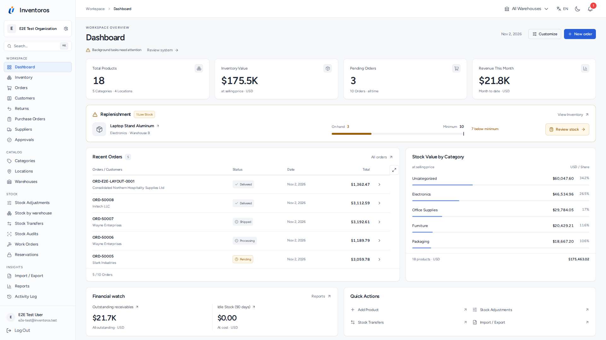
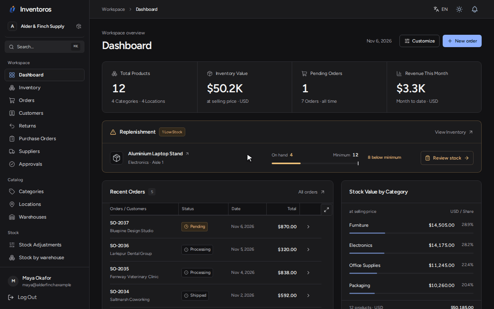
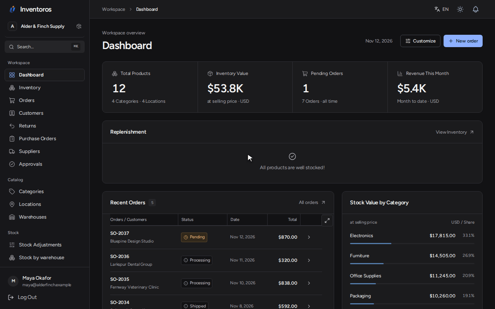
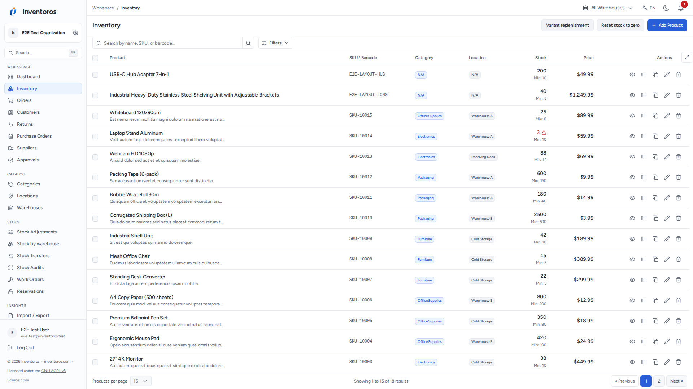
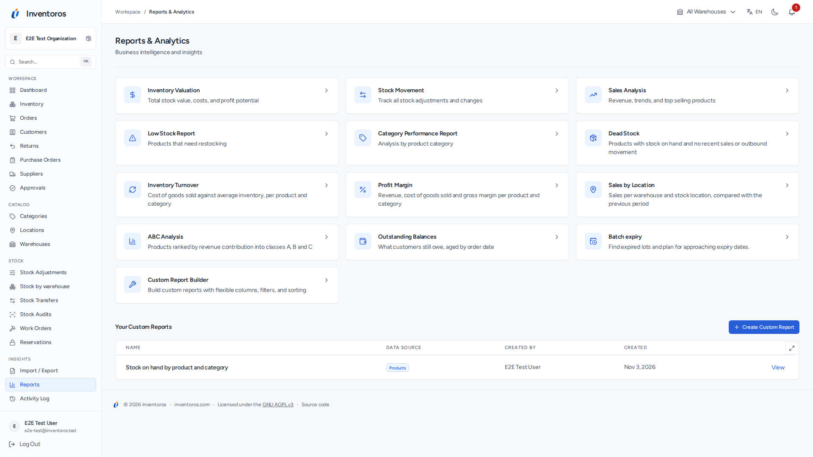

<p align="center">
  <a href="https://inventoros.com"></a>
</p>

<h1 align="center">Inventoros</h1>

<p align="center">
  Inventory management for the rest of us.<br>
  Open-source inventory and warehouse management you host yourself: stock, orders, purchasing and shipping in one place.
</p>

<p align="center">
  <a href="https://inventoros.com"><b>Website</b></a> ·
  <a href="https://inventoros.com/docs"><b>Docs</b></a> ·
  <a href="https://inventoros.com/docs/getting-started"><b>Install</b></a> ·
  <a href="CHANGELOG.md"><b>Changelog</b></a>
</p>

<br>

<picture>
  <source media="(prefers-color-scheme: dark)" srcset="screenshots/dashboard.png">
  
</picture>

## What it does

<table>
  <tr>
    <td width="40%">
      <h3>Restock before you run out</h3>
      Minimum levels flag low stock on the dashboard. Raise a purchase order, receive it into the right bin, and the alert clears.
    </td>
    <td width="60%">
      
    </td>
  </tr>
  <tr>
    <td width="60%">
      
    </td>
    <td width="40%">
      <h3>From order to shipment</h3>
      Write up an order for a saved customer, take payment, buy a label and mark it shipped. Customers can follow it in their own portal.
    </td>
  </tr>
  <tr>
    <td width="40%">
      <h3>Every warehouse, down to the bin</h3>
      Warehouses, aisles, shelves and bins, with transfers between sites and staff limited to the warehouses they work in.
    </td>
    <td width="60%">
      <picture>
        <source media="(prefers-color-scheme: dark)" srcset="screenshots/products.png">
        
      </picture>
    </td>
  </tr>
  <tr>
    <td width="60%">
      <picture>
        <source media="(prefers-color-scheme: dark)" srcset="screenshots/reports.png">
        
      </picture>
    </td>
    <td width="40%">
      <h3>Reports you'll actually open</h3>
      Valuation, stock movement, dead stock, turnover, margins and ABC analysis. Extend it with plugins, a REST and GraphQL API, and webhooks.
    </td>
  </tr>
</table>

## Features

<table>
<tr>
<td width="33%" valign="top">

**Inventory and products**
- SKUs, pricing, categories, barcodes
- Variants by size, colour, material
- Kits and bundles from components
- Assembly and work orders
- Batch, lot, expiry and serial tracking
- Code 128, EAN, UPC, Code 39, QR labels
- Camera and keyboard-wedge scanning
- SKU patterns with auto-generation
- CSV import and export
- Cycle counts and stock audits

</td>
<td width="33%" valign="top">

**Warehouses**
- Multiple warehouses with contacts
- Staff limited to their warehouses
- Warehouse switcher on every view
- Transfers with tracking and transit status
- Default warehouse per organization
- Per-warehouse reorder points and capacity
- Warehouse, aisle, shelf, bin

</td>
<td width="33%" valign="top">

**Orders and purchasing**
- Order lifecycle with automatic stock updates
- Order approval: pending, approved, rejected
- Discounts, payments, refunds, AR aging
- PDF invoices emailed to customers
- Returns and exchanges (RMA)
- Purchase orders emailed to suppliers
- Receive into a chosen bin
- Supplier price history and ratings
- Reorder points that draft purchase orders

</td>
</tr>
<tr>
<td width="33%" valign="top">

**Shipping and fulfilment**
- Pick lists and price-free packing slips
- Partial and manual shipments
- EasyPost rates, labels, tracking, voids
- Tracking webhooks with polling backstop
- Optional shipment emails

</td>
<td width="33%" valign="top">

**Customer portal**
- B2B portal per organization
- Orders, shipments, payments, balance
- Invoice PDFs and return requests

</td>
<td width="33%" valign="top">

**Approvals**
- Purchase orders, adjustments, transfers
- Thresholds per workflow
- Pending approvals page with a count
- Every workflow off by default

</td>
</tr>
<tr>
<td width="33%" valign="top">

**Reports**
- Valuation, movement, sales, margin
- Low stock, dead stock, turnover, ABC
- Custom report builder over 6 sources
- Export to CSV, Excel or PDF
- Scheduled report emails

</td>
<td width="33%" valign="top">

**Users and access**
- 30+ granular permissions
- Custom roles and permission sets
- Two-factor authentication (TOTP)
- API token management

</td>
<td width="33%" valign="top">

**APIs**
- REST API v1
- GraphQL with depth and complexity limits
- MCP server for AI clients
- OpenAPI spec, served at `/docs/api`
- Sanctum tokens with scoped abilities

</td>
</tr>
<tr>
<td width="33%" valign="top">

**Plugins**
- Hooks and filters
- Plugin pages, widgets, menus, tabs
- Signed plugins from the marketplace
- Sample plugin with documentation

</td>
<td width="33%" valign="top">

**Notifications and webhooks**
- Email via SMTP, Mailgun, SendGrid
- Templates and per-user preferences
- Signed webhooks with retries and logs

</td>
<td width="33%" valign="top">

**Platform**
- Multi-tenant organizations
- Install wizard and update manager
- Automatic backups before updates
- Activity log with export
- Dark mode and Ctrl+K command palette
- 1000+ automated tests

</td>
</tr>
</table>

<p align="center"><sub><a href="docs/feature-overview.md">Every feature in detail</a></sub></p>

<p align="center">
  <a href="https://laravel.com"></a>
  <a href="https://www.php.net"></a>
  <a href="https://vuejs.org"></a>
  <a href="https://inertiajs.com"></a>
  <a href="https://tailwindcss.com"></a>
  <a href="https://www.postgresql.org"></a>
</p>

## Quick start

On a Linux server, one command installs Docker, generates secrets and starts everything:

```bash
curl -fsSL https://inventoros.com/install.sh -o install.sh
less install.sh
sudo bash install.sh
```

Docker Compose, Coolify, cPanel and manual installs are in the [installation guides](https://inventoros.com/docs/getting-started). Upgrading from 1.0.x? Follow [UPGRADE.md](UPGRADE.md) once.

## Learn more

- [All features](docs/feature-overview.md) · [Screenshots](docs/screenshots.md)
- [Requirements, development setup and configuration](docs/development.md) · [cPanel deployment](CPANEL.md)
- [API guide](docs/api/README.md) · [Endpoint list](docs/api-endpoints.md) · [MCP server](docs/mcp/README.md)
- [Plugin development](docs/PLUGIN_DEVELOPMENT.md) · [External file storage](docs/external-storage.md)
- [Contributing](CONTRIBUTING.md) · [Community and support](docs/community.md) · [Security policy](SECURITY.md)

## License

Copyright (c) 2025-2026 Inventoros ([inventoros.com](https://inventoros.com)).

Inventoros is free, open-source software licensed under the [GNU Affero General Public License v3.0](LICENSE) (AGPL-3.0-only). If you run a modified version of Inventoros as a network service, the AGPL requires you to offer your users the source code of that modified version.

Releases up to and including v1.0.8 were published under the MIT license and remain available under those terms.
