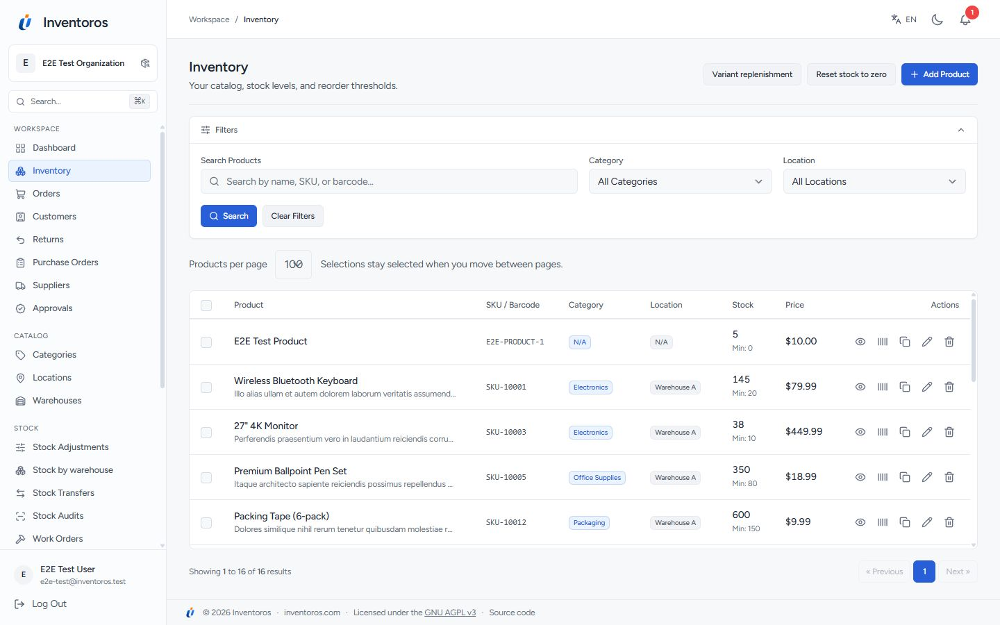
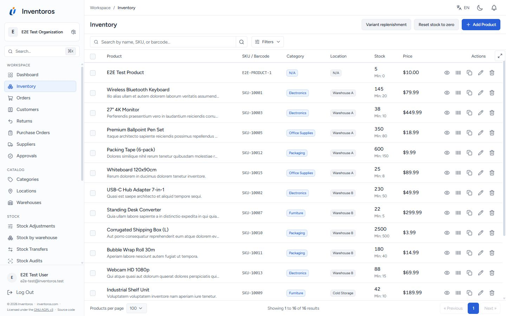
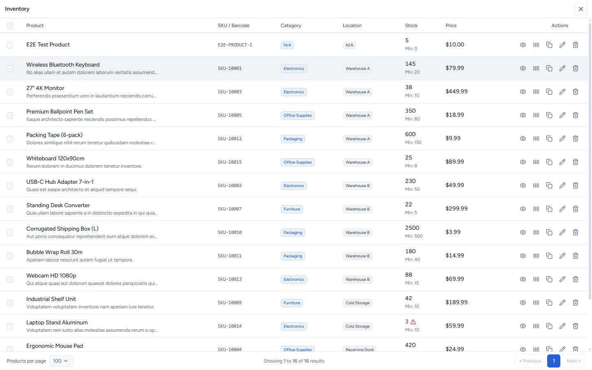

# Table workspace audit - 2026-11-01

The previous change added scrolling to selected lists, but left the grid too
small. The reference is an operational workspace like
[ShipStation's orders grid](https://www.shipstation.com/fulfillment/order-management/):
compact controls, a dominant grid, persistent column headings and access to
the current page's actions and pagination.

## Findings and fixes

| Priority | Finding | Result |
| --- | --- | --- |
| P1 | Inventory had only 371 px of table height at 1440 x 900; the table started 418 px below the top | Grid now starts at 142 px and has 713 px of scrolling height |
| P1 | 55 of 71 Vue table templates did not use the shared scrolling component | All 71 now use `TableViewport`, including reports, detail pages, editable rows and the customer portal |
| P1 | Large headings, expanded filters, separate page-size controls, margins and the legal footer competed with the table | Compact workspace header, search toolbar, filter popover, page size beside pagination, legal links in the navigation |
| P2 | A bounded table still needed a way to occupy the whole window | Every table has a Full table view control; the same live table moves into a native modal |
| P2 | Full view could lose form state, keyboard focus or access to row-action dialogs | Preserve edited cells and selections; restore focus and scroll position; Escape closes; hand off to row-action modals without leaving the page locked |
| P2 | Paging controls could be left behind when expanding primary lists | Table footer slots carry primary-list pagination into full view, outside the row scroller |
| P2 | Mobile actions and pagination consumed several lines | Actions disclosure and compact inventory pagination leave 571 px for the grid at 375 x 812 |

## Measured layout

Values are the row scroller's `clientHeight`, including its column headings.
They come from the actual local application with demo data, not a static mockup.

| Viewport | View | Table height |
| --- | --- | ---: |
| 1440 x 900 | Inventory before | 371 px |
| 1440 x 900 | Inventory after | 713 px |
| 1440 x 900 | Inventory in Full table view, with pagination | 811 px |
| 1440 x 900 | Embedded report in Full table view | 856 px |
| 1920 x 1080 | Inventory workspace | 893 px |
| 375 x 812 | Inventory workspace | 571 px |

At 1440 x 900, the 17 primary table pages provided approximately 701-803 px
of scrolling height. Their document height stayed at 900 px. These include
inventory, orders, customers, returns, purchase orders, suppliers, warehouses,
stock adjustments, warehouse stock, transfers, audits, work orders, reservations,
users, API tokens, webhooks and saved reports.

### Before

### After

### Full table view

## Coverage and behavior

- Primary list screens fill the available application workspace. Only rows
  scroll vertically or horizontally; headings and pagination remain visible.
- Reports, dashboards and detail/form pages keep their surrounding context.
  Their tables have a bounded scroll region and can expand to the window.
- All first-party Vue table templates in `resources/js` use the shared
  component. The two main `DataTable` consumers inherit it as well.
- Existing responsive card alternatives remain available on small screens.
  Printing restores normal flow so the table's full contents can print.
- Full view moves the existing DOM rather than rendering a second table.
  Quantity inputs, selections and Vue event handlers stay attached.
- Row actions that open another dialog leave full-table mode and preserve
  the correct body scroll lock until that dialog closes.
- No record filtering, calculations, permissions or database queries changed.

## Verification

- Production frontend build passed; 200 JavaScript checks passed.
- A template audit now fails if a future first-party table omits the shared
  scrolling/full-view component.
- Checked the 17 primary list layouts in the running application, including
  empty tables, and inspected desktop, wide and phone screenshots.
- Checked a report in full view and an editable stock audit with 35 lines.
  Count edits survived expansion and Escape; focus returned to the trigger.
  Review dialogs remained interactive and released their scroll lock on close.
- E2E regression coverage checks table height, stationary headings/pagination,
  phone actions and filters, selection preservation, full-window dimensions,
  report tables, editable audit rows and row-action dialog handoff.

The audit covers first-party Vue tables. Third-party plugins that render their
own markup should import `TableViewport` to adopt the same behavior.
