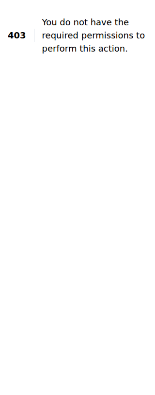
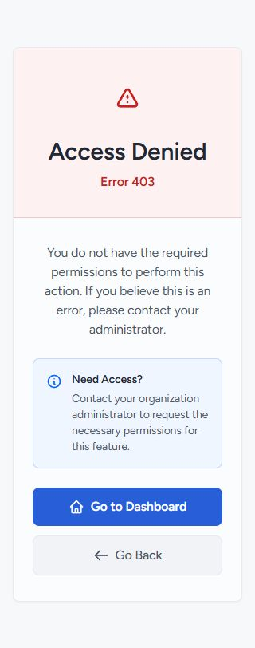
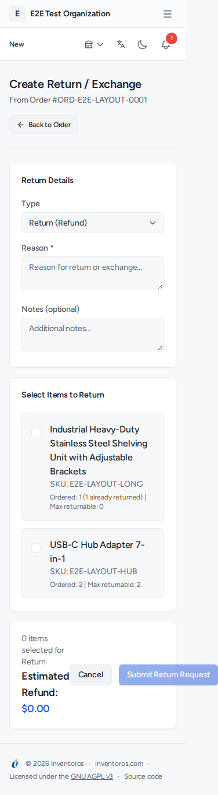
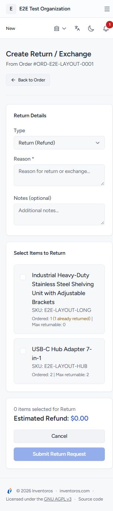

# Rendered before/after evidence

Chrome, 320px viewport, disposable QA data. Before captures come from the corrected route sweep and initial conditional-state sweep. After captures use the final audit implementation. Full-page return screenshots include the original overflow area, so their image widths differ; the corrected document is exactly 320px wide.

## Permission recovery

The initial direct visit returned the framework's plain error. The corrected page uses Inventoros styling, localized guidance and working recovery actions. JSON response contracts are unchanged.

| Before | After |
| --- | --- |
|  |  |

## Mobile return form

Item content wraps without squeezing and the summary/actions stack within the viewport. The final form was also exercised with an item selected; quantity, condition, restock and submit controls stayed reachable without document overflow.

| Before | After |
| --- | --- |
|  |  |

The [public screenshot gallery](../../../screenshots) contains the regenerated light/dark operational views. Full route/locale/state captures are retained as GitHub Actions artifacts linked in [the audit report](../../../UI_UX_AUDIT.md).

## Full-height operational workspace

The desktop [after capture](workspace-after.png) measures 1920x911. The document has no horizontal or vertical overflow; the table occupies 724px and independently scrolls 891px of row content.
