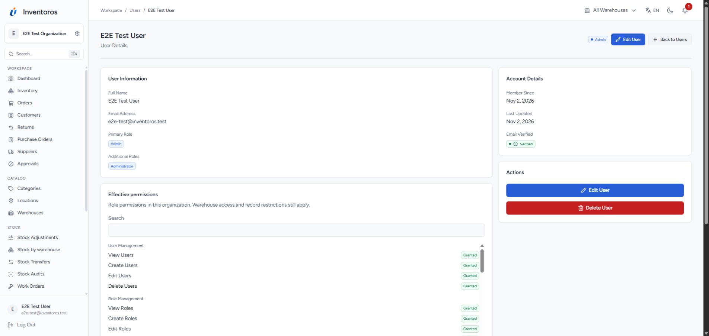
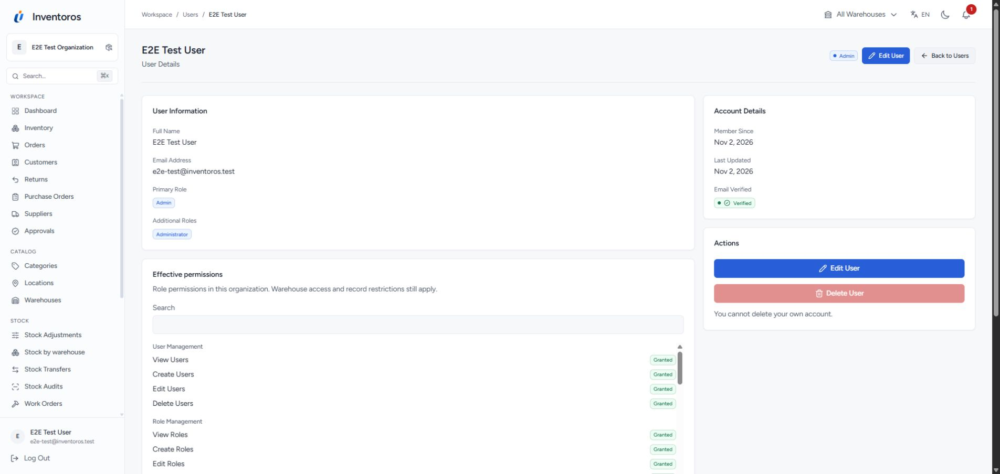
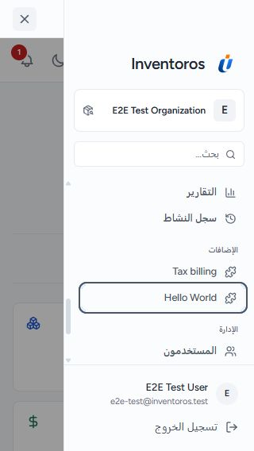
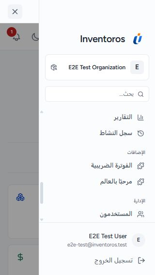
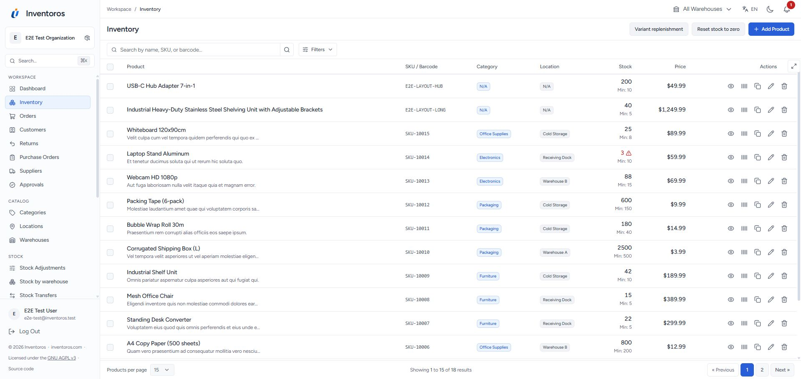
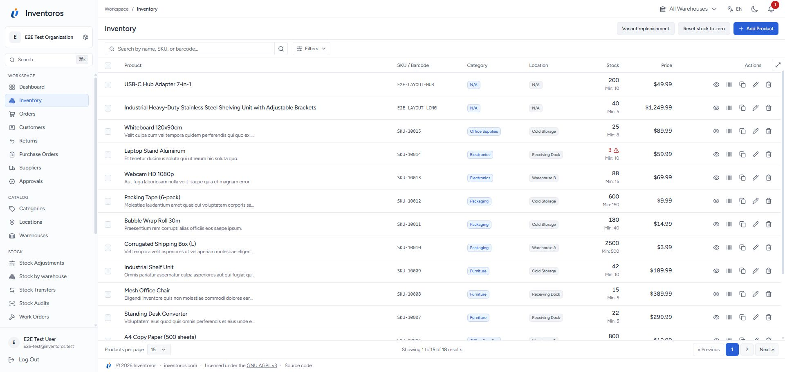

# Rendered before/after evidence

Chrome, 320px viewport, disposable QA data. Before captures come from the corrected route sweep and initial conditional-state sweep. After captures use the final audit implementation. Full-page return screenshots include the original overflow area, so their image widths differ; the corrected document is exactly 320px wide.

## Permission recovery

The initial direct visit returned the framework's plain error. The corrected page uses Inventoros styling, localized guidance and working recovery actions. JSON response contracts are unchanged.

| Before | After |
| --- | --- |
|  |  |

## Mobile return form

Item content wraps without squeezing and the summary/actions stack within the viewport. The final form was also exercised with an item selected; quantity, condition, restock and submit controls stayed reachable without document overflow.

| Before | After |
| --- | --- |
|  |  |

The [public screenshot gallery](../../../screenshots) contains the regenerated light/dark operational views. Full route/locale/state captures are retained as GitHub Actions artifacts linked in [the audit report](../../../UI_UX_AUDIT.md).

## Full-height operational workspace

The desktop [after capture](workspace-after.png) measures 1920x911. The document has no horizontal or vertical overflow; the table occupies 724px and independently scrolls 891px of row content.

## Second audit: account actions and runtime localization

Account actions at 1920x911, using the disposable administrator account. The unavailable delete action now has a visible explanation. Rejected delete/approval feedback is separately verified with non-writing browser response fixtures.

| Before | After |
| --- | --- |
|  |  |

The [notification capture](notifications-after.png) shows a real unread record loaded from the existing Inertia endpoint. The [Arabic plugin capture](plugin-ar-mobile-after.png) shows translated runtime content at 320x568.

The second pass also caught stale sidebar labels after an asynchronous plugin bundle loaded. Both captures use Arabic at 320x568 with the same links focused and scrolled into view.

| Before | After |
| --- | --- |
|  |  |

The [final workspace capture](workspace-second-pass.png) retains the 724px scrolling table at 1920x911, with no document overflow.

## Release refinement: legal footer beneath table controls

The legal footer moves from the sidebar to one line below table pagination and
actions. At 1920x911, the compact 33px footer leaves a 691px table viewport;
neither document axis scrolls. Expanded tables use the same bottom row. On a
narrow screen the footer can scroll horizontally while keeping 12px text and
all links keyboard-reachable.

| Before | After |
| --- | --- |
|  |  |

[Mobile expanded table capture](table-footer-mobile-after.png).
