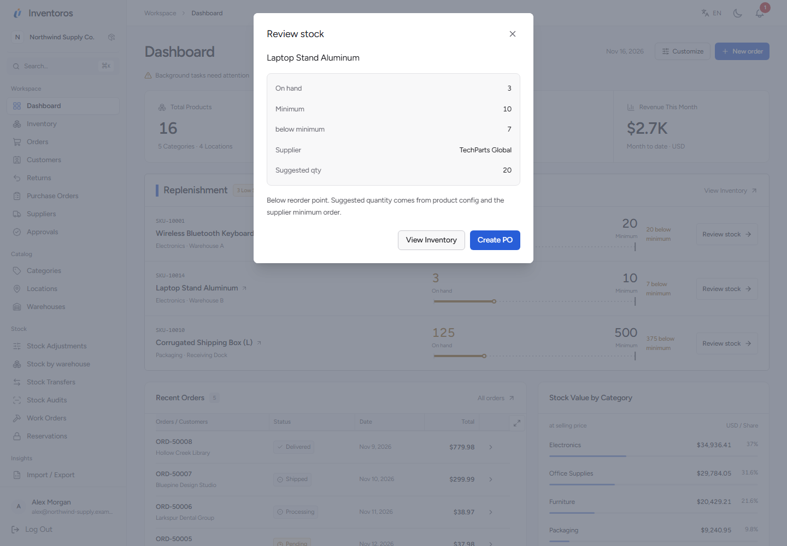
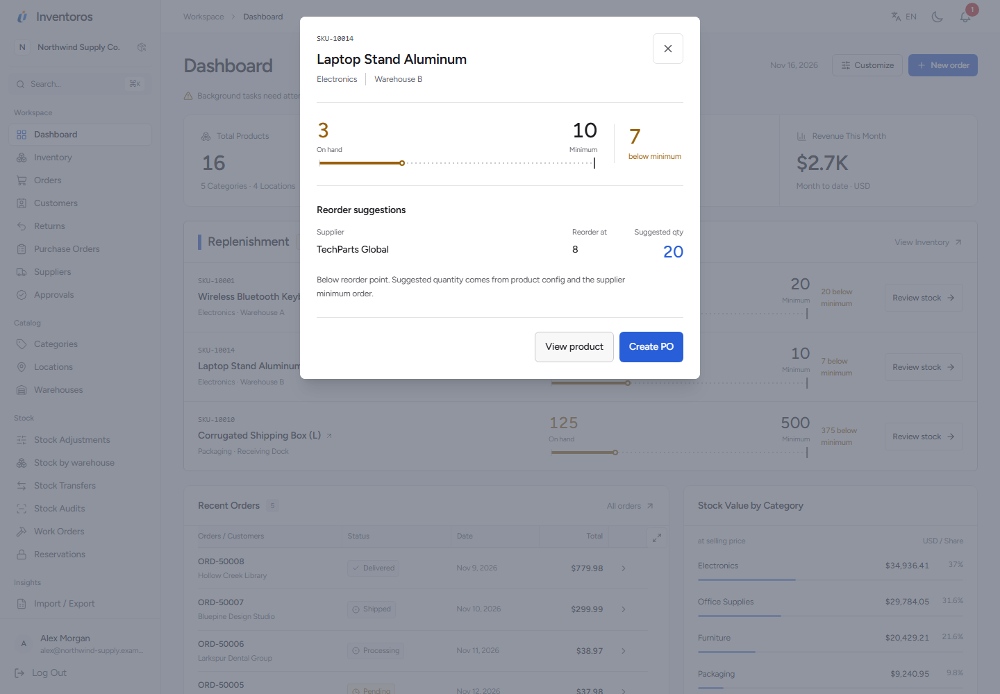
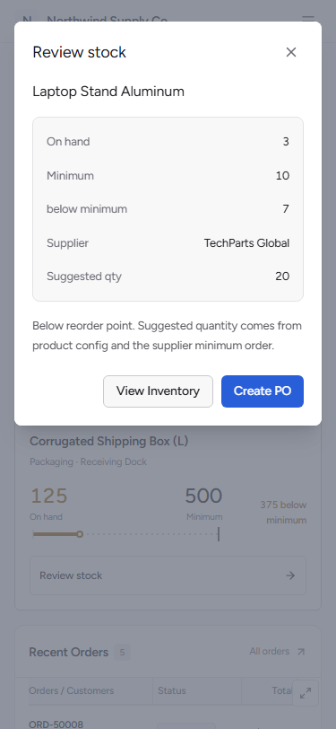
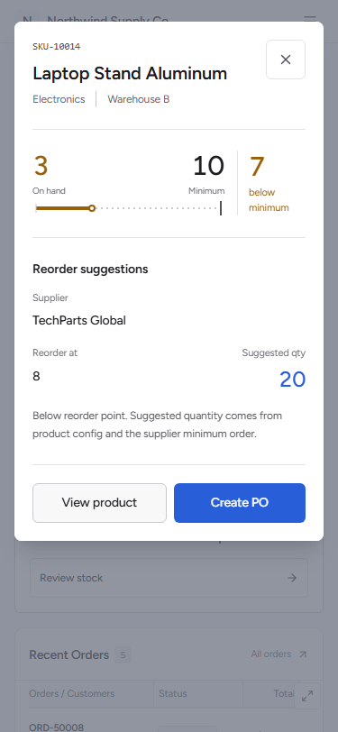
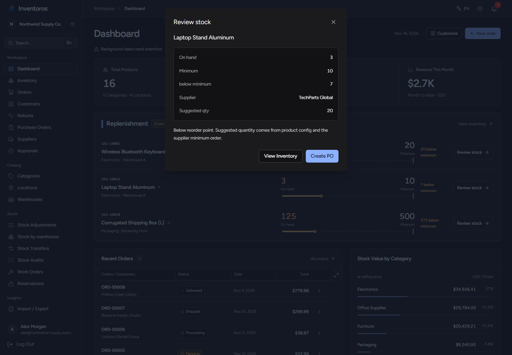
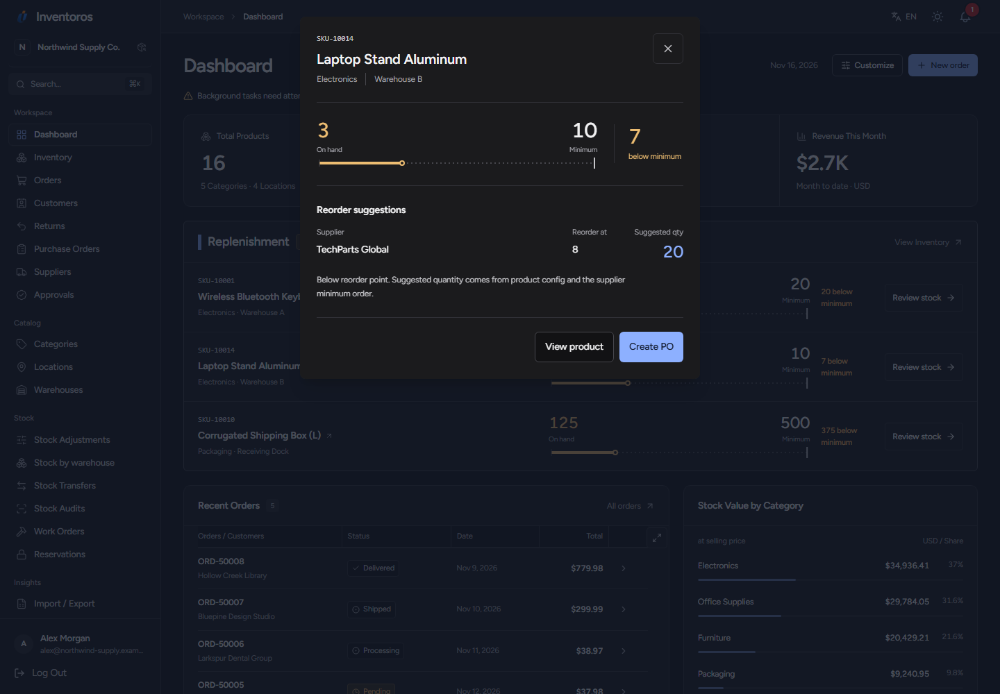
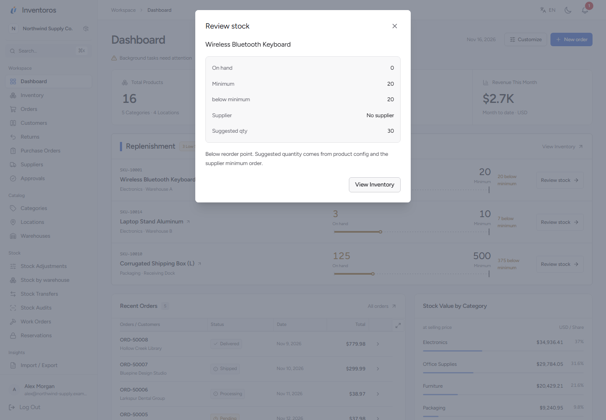
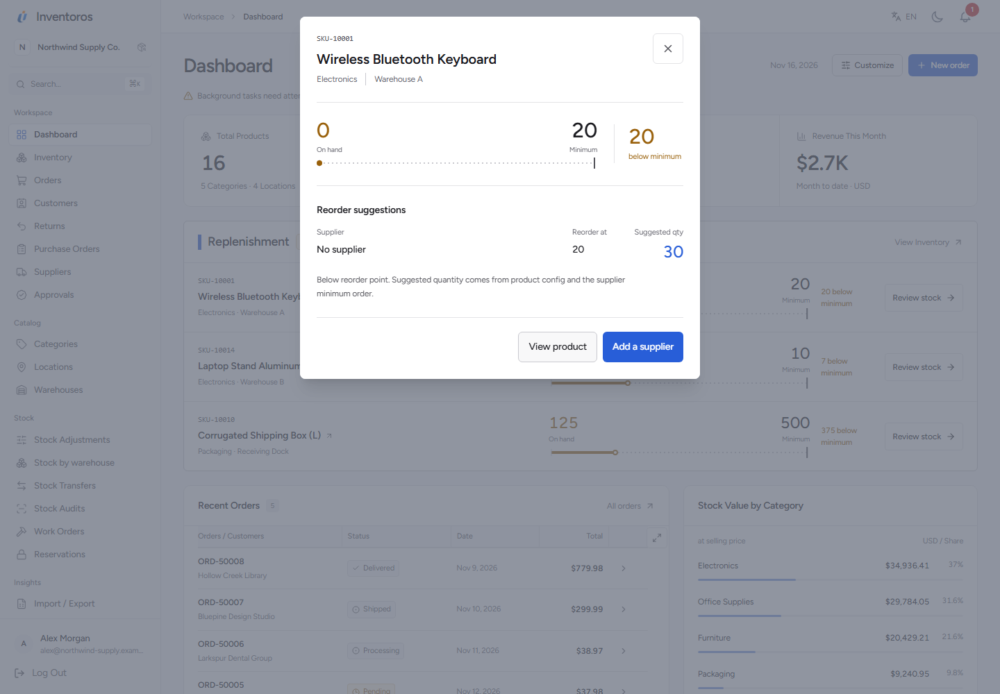
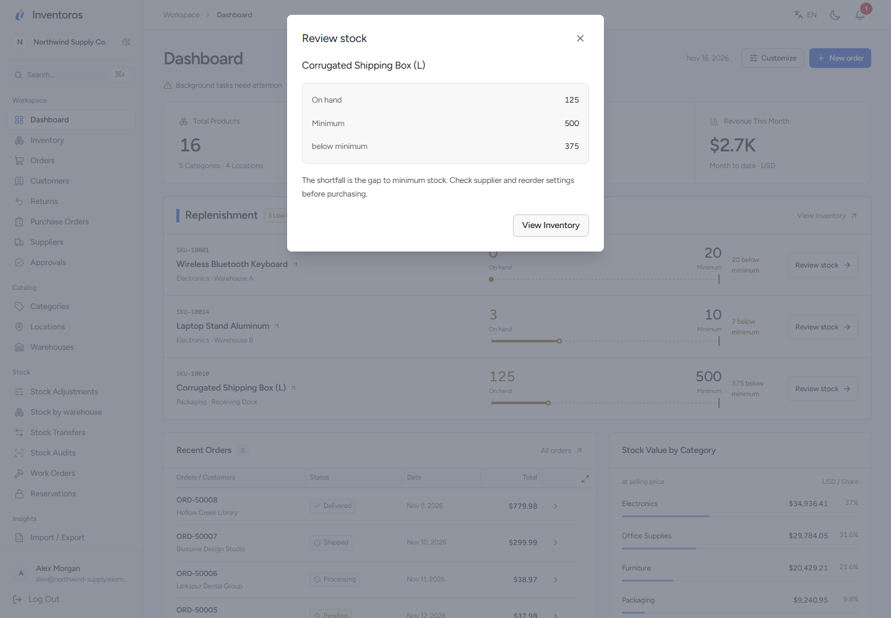
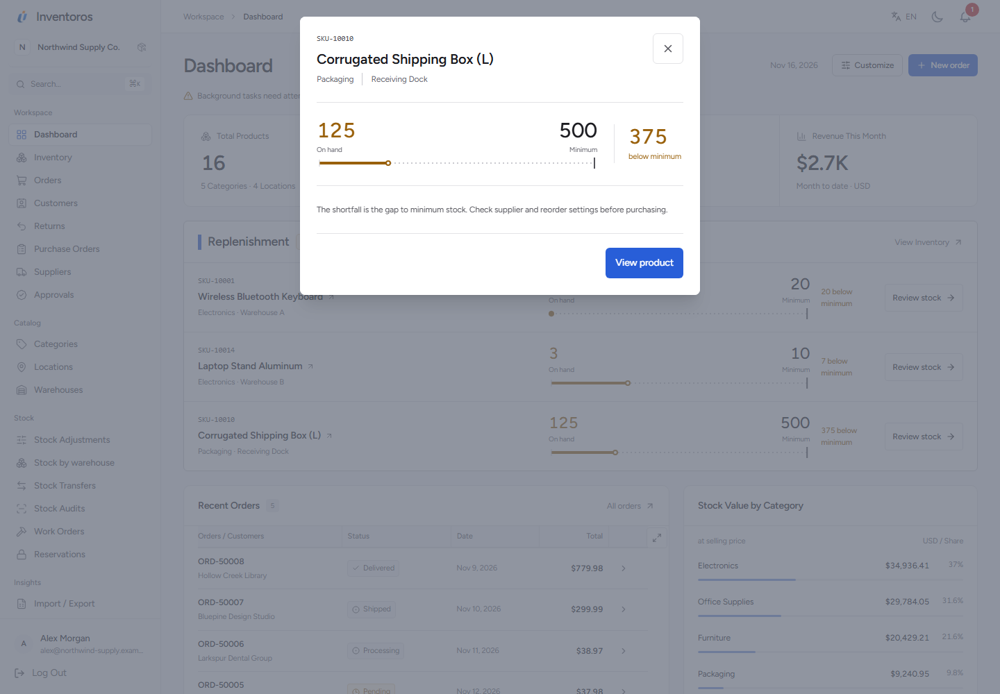

# Stock review sheet

Follow-up to the replenishment styling in PR #401. The existing primary stats stay first; this change affects the Review stock dialog opened from a replenishment record.

The dialog repeats the record's SKU, name, category, location, and stock ruler. The minimum shortfall is separated from procurement facts: supplier, reorder point, and server-suggested order quantity. The fixture deliberately shows **3 on hand / 10 minimum / 7 below minimum**, alongside **20 suggested units** because the supplier minimum exceeds the configured quantity of 12. The UI displays the server suggestion; it does not infer the supplier minimum from that number.

The next action follows the available data and permissions:

- An eligible supplier-linked record can create a draft PO.
- A record without its primary supplier offers Add a supplier when editing is permitted.
- A product requiring specific variants offers Choose variants and does not present its aggregate suggestion as a directly orderable quantity.
- A record without a suggestion keeps its shortfall explanation and View product action. It does not claim that its supplier is missing.
- A failed submission stays inside the review, with an announced error and a retryable Create PO action. Pending submission cannot send another request.

The existing Modal supplies focus containment, Escape, background inertness, scrolling, and focus restoration. Review controls have 44 px targets, translated labels wrap, large exact quantities remain within the dialog, and the shared semantic tokens support dark mode. Two new strings are included in every supported catalog.

## Before and after

Actual Chromium captures on PR #401 at `3db69804` and this branch. Both use the same isolated demo database and supplier/reorder fixture. Desktop/dark are 1440 × 1000; phone is 375 × 812. The main dashboard behind the dialog retains the primary stats-first hierarchy.

| State | Before | After |
| --- | --- | --- |
| Supplier, desktop |  |  |
| Supplier, phone |  |  |
| Supplier, dark |  |  |
| No supplier |  |  |
| No suggestion |  |  |

## Verification

- Production build and 226 JavaScript tests pass, including text localization and catalog parity.
- Ten new browser checks cover four viewport widths, identity and quantity accuracy, focus restoration, pending submission, duplicate prevention, network failure/retry, server validation, supplier/variant/permission states, Arabic, large quantities, and Axe within the review.
- The 22 existing dashboard browser checks also pass, including the primary-stats-first invariant.
- Reorder PHP tests verify the existing supplier, quantity, and draft-order behavior. No backend calculation changes are included.

The shared quick-reorder composable accepts optional scoped feedback callbacks. Existing table/report callers keep their default Inertia behavior. The review honors `can_quick_reorder: false`, matching the existing suggestions table and backend variant restriction.

## Reproduce

Prepare the disposable fixture documented in `../dashboard-stockroom/README.md`, then run `php docs/design/dashboard-review-sheet/seed.php`. This script refuses non-SQLite connections, non-fixture environments, and databases not named `dashboard-design.sqlite`.

Run `capture.mjs before` against the base revision and `capture.mjs after` against this branch, using the fixture login created by the stockroom capture script. `CAPTURE_BASE_URL` overrides the local default. The capture script opens reviews without submitting a purchase order.

Run `npx playwright test e2e/tests/dashboard-review.spec.ts --project=setup --project=chromium` for the browser regression suite, also included in CI.
