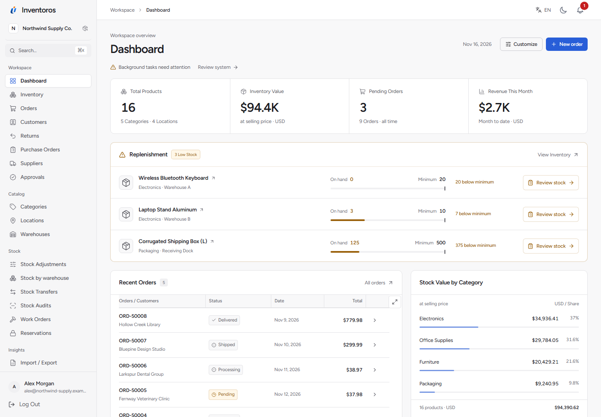
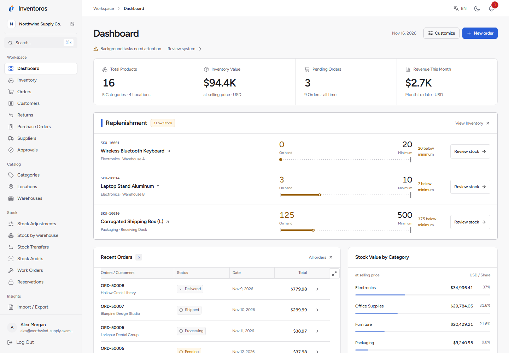
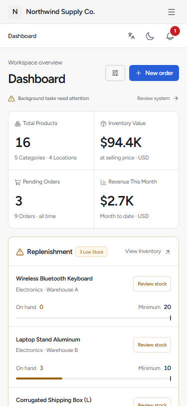
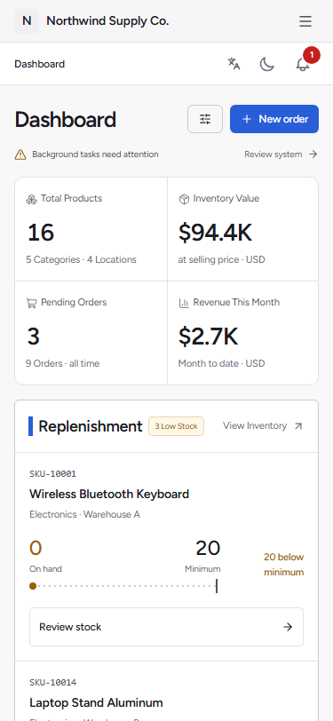
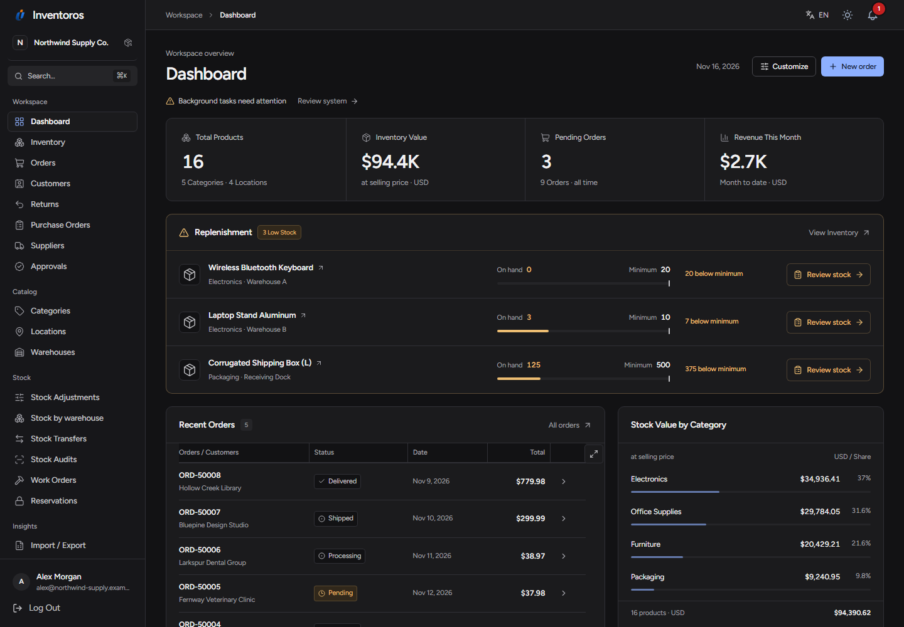
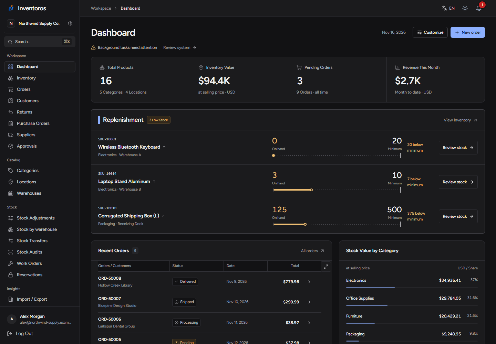
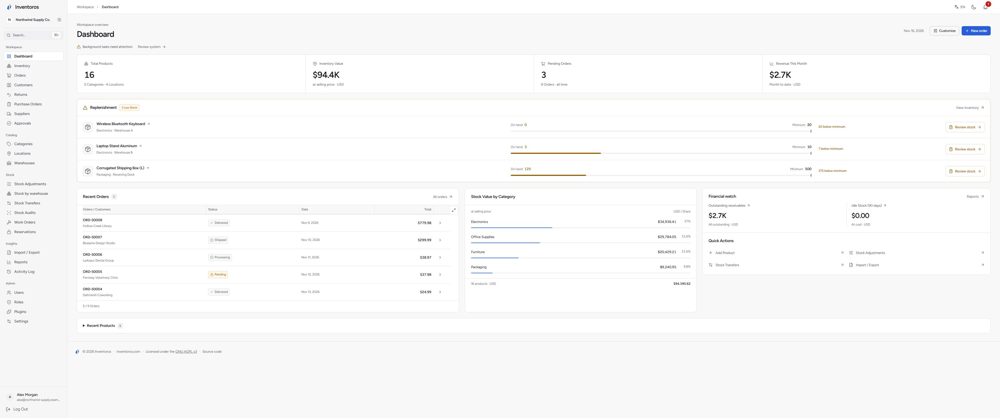
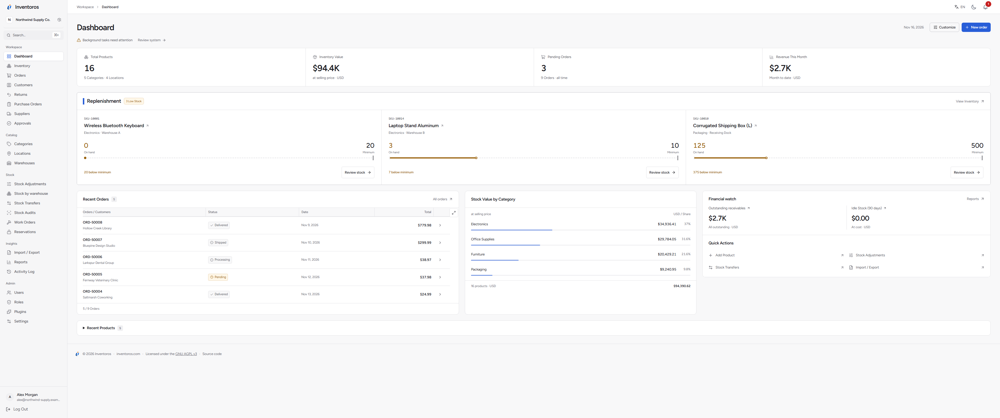

# Inventoros stockroom workbench

This is a proposed dashboard direction for design review. It keeps the existing product shell and styling system while giving the dashboard an inventory-specific centre: SKU labels and minimum-stock rulers within the existing replenishment panel. The primary stats strip remains first and retains its original styling at every screen size.

## Design question

**What is the current inventory and order position, and which stock records need attention?** The established product, valuation, order, and revenue stats remain prominent at the top. The replenishment panel below them gains more recognisable, inventory-specific record styling.

Its repeated visual form is an actual stock measurement: solid on-hand quantity, a dashed gap, and a minimum marker. It is neither a history chart nor a forecast. SKU and location identify each record.

```text
Dashboard                                      date / controls
Total products | Inventory value | Pending orders | Revenue
Replenishment
SKU / name / location | 3 ... 10 | gap | Review
SKU / name / location | 0 ... 20 | gap | Review
Recent orders                                  Category valuation
Financial watch / existing stock actions
```

The same stats-first order applies on phones. On ultrawide displays, replenishment records become adjacent stock tickets, allowing meaningful comparison rather than stretching one thin row across the screen. Record layouts fold based on their actual panel width so tablet sidebars do not clip actions.

### Visual choices

The palette is inherited from the shared light/dark tokens: canvas `#F8F8F9`, raised surface `#FFFFFF`, primary text `#1C1C21`, border `#E3E3E6`, Inventoros blue `#285ED8`, and warning amber `#99600A` in light mode. Alternate themes continue to use the existing semantic tokens.

Keep the existing Inter/Figtree sans stack. Use tabular numerals for quantity comparison and an 11 px monospace role for actual SKU identifiers. The larger on-hand/minimum pair earns its prominence by supporting the next decision. No new font, dependency, animation, brand palette, or synthetic trend is introduced.

The visual distinction comes from the stock records rather than replacing the established stats hierarchy. Real minimum thresholds provide the context; no health score is invented.

### Considered and rejected

- A warehouse map: the dashboard has no warehouse-level layout or capacity data to make it truthful.
- A prominent inventory-health percentage: product counts, variants, active status, and shortages do not currently provide a sound single health metric.
- Decorative barcodes or industrial textures: they add stockroom styling without helping anyone identify a record or make a decision. Actual SKU labels do.
- A new navigation shell or palette: the existing product identity should evolve through its working surfaces.

## Before and after

Actual Chromium captures of main at `37166232` and this branch, using the same disposable database and initial scroll position. Desktop/dark are 1440 × 1000; wide is 3440 × 1440; phone is 375 × 812. Full phone captures are also included beside the viewport captures.

| View | Before | After |
| --- | --- | --- |
| Desktop |  |  |
| Phone |  |  |
| Dark |  |  |
| Wide |  |  |

The primary stats keep their established format and come before replenishment on every viewport. The desktop snapshot, supporting tables, and controls retain their data. Phone records take more room to keep identifying text, quantities, and 44 px Review actions readable.

## Data and verification

The screenshot seeders create a demo company. `seed.php` then sets three clearly synthetic shortage scenarios in `dashboard-design.sqlite` only. It refuses other database filenames and non-fixture environments. Exported raw records and independent expected totals accompany the images:

- 16 products; USD 94,390.62 at selling price.
- 3 pending orders from 9 orders; USD 2,721.85 month-to-date revenue in this fixture.
- Keyboard: 0 on hand / 20 minimum / 20 shortfall.
- Stand: 3 on hand / 10 minimum / 7 shortfall.
- Shipping box: 125 on hand / 500 minimum / 375 shortfall.

`verify.mjs` compares the rendered metrics, every shortage and accessible ruler label, and the sum of category valuations against those independent answers. No live database is involved.

Verification includes the production build, all 226 JavaScript tests, 52 dashboard PHP tests (541 assertions), and 22 focused Chromium checks. The browser checks cover quantity accuracy, variant-effective stock, eight viewport widths, empty and healthy catalogs, missing permission-gated values, the stats-first hierarchy, hidden widgets, full-width runtime plugin placements, Arabic direction, 44 px phone targets, and high contrast. Axe reports no violations in the changed replenishment panel. Colour-deficiency captures were inspected for achromatopsia, deuteranopia, protanopia, and tritanopia; labels and positions retain the meaning independently of colour.

All existing widget preference keys, metrics, permissions, server aggregates, reorder logic, and extension names remain. `before-stats`, `after-stats`, and `before-content` retain their original order and full-width placement. The dashboard still uses server snapshots, so this change does not introduce a separate loading, stale-data, or fetch-error model.

## Follow-up ideas

1. Carry the SKU label and stock ruler into the Review stock dialog, separating the gap to minimum from an actual supplier-order quantity. This is the next proposed PR.
2. Explore a receiving/dispatch lane using actual purchase-order and shipment counts. That needs scoped backend data and permission checks; the current dashboard payload does not support inventing it.
3. Reuse the stock-ruler grammar on product stock details and count review, where minimum, counted stock, and variance are distinct concepts. Keep the visual relationship consistent while preserving those meanings.

## Reproduce

Use an isolated local installation with an SQLite database named `dashboard-design.sqlite`. Run the migrations, `ScreenshotSeeder`, `ScreenshotBrandingSeeder`, then `php docs/design/dashboard-stockroom/seed.php` and `node docs/design/dashboard-stockroom/expectations.mjs`. The screenshot user is the demo user defined by those seeders. The revenue expectation follows the capture month's records.

Build and serve the target revision, then run `node docs/design/dashboard-stockroom/capture.mjs before` on main and `capture.mjs after` on this branch. `CAPTURE_BASE_URL` can override the local default. `verify.mjs` runs against the captured fixture login and expects the after implementation.

The normal regression command is `npx playwright test e2e/tests/dashboard-stockroom.spec.ts --project=setup --project=chromium`; this spec is also included in the PR workflow.

Direction uses the local Dashboard Design and Frontend Design skills, plus [Real Content Design](https://www.ui-skills.com/skills/kemiljk/dxe-real-content-design/llms.txt) and [Subtractive Design](https://www.ui-skills.com/skills/kemiljk/dxe-subtractive-design/llms.txt), retrieved through the UI Skills MCP catalog.
