# Product form polish

The create and edit forms retain Inventoros's existing surfaces, type, blue primary actions, navigation, and components. This pass improves how the existing fields fit together:

- Pair barcode/type, product type/category, cost/selling price, stock/minimum, reorder point/quantity, and location/tracking when the card has enough room. Container queries keep narrow cards in one column, including intermediate desktop widths.
- Separate pricing from stock with an existing translated heading and a divider. Category sits with the product's basic information.
- Keep Save and Cancel reachable while scrolling, with 44 px phone targets, wrapping translated labels, safe-area padding, and document scroll clearance for keyboard focus and native validation.
- Use section headings below the page heading and tabular digits in the existing profit display.

The desktop create form is 309 px shorter (2115 to 1806 px); edit is 317 px shorter (2117 to 1800 px). Phone forms remain a single column. Their action bar is visible from the initial viewport.

## Browser comparisons

These are actual Chromium captures, not mockups. Before is main at `a3bee820f900433f8f553299877e5b3ad76c5057`; after is this branch. Both use the same isolated SQLite demo fixture created by `ScreenshotSeeder` and `ScreenshotBrandingSeeder`, including the same keyboard product, values, and description. No live application database is involved.

Desktop and dark: 1440 × 1000. Phone: 375 × 812. Each pair uses matching viewport dimensions, device scale, theme, and initial scroll position.

| Surface | Before | After |
| --- | --- | --- |
| Create, desktop | 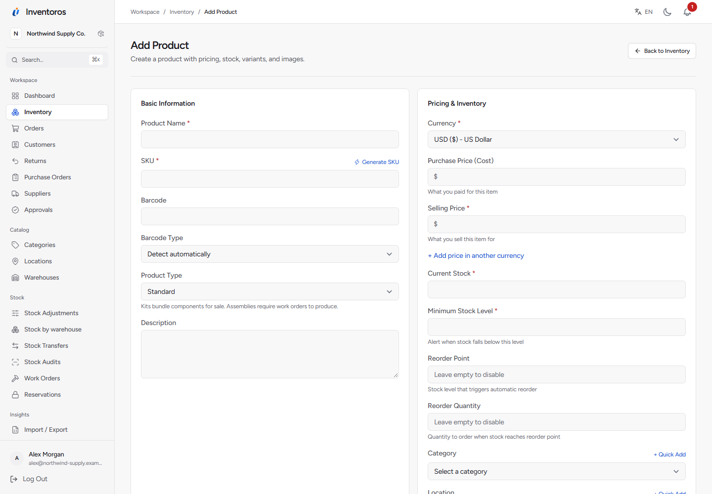 | 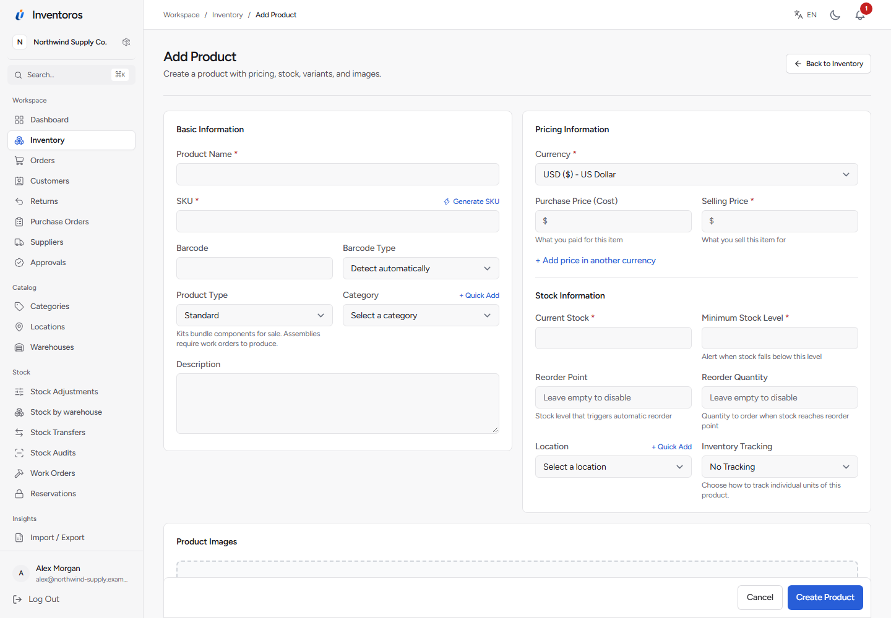 |
| Edit, desktop | 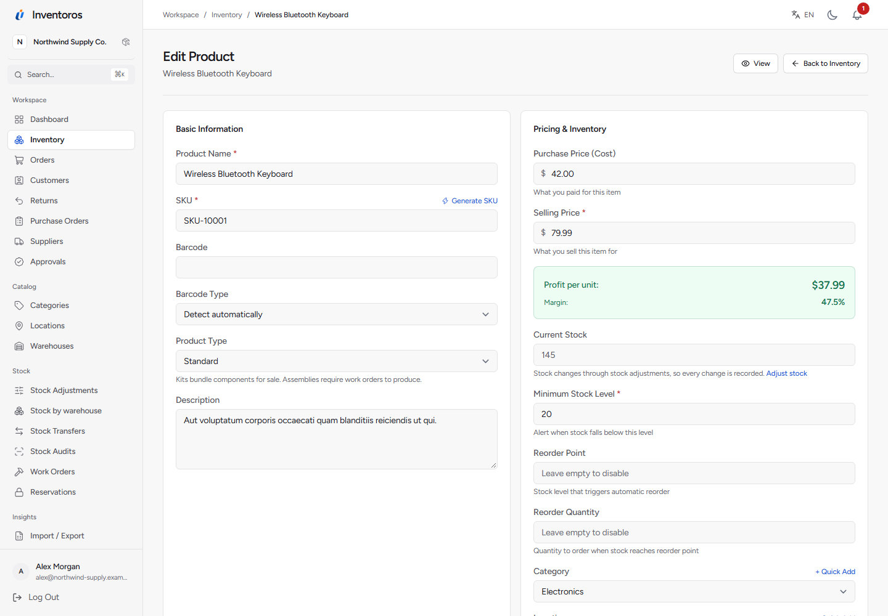 | 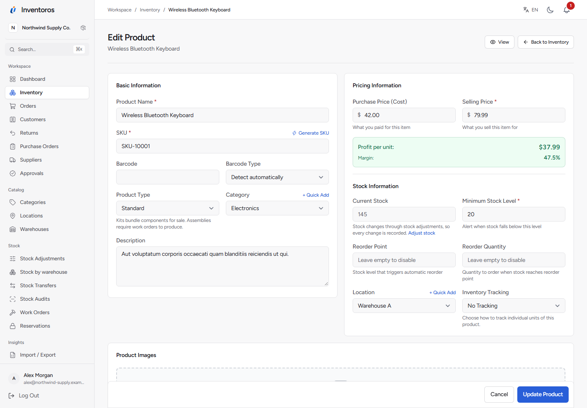 |
| Create, phone | 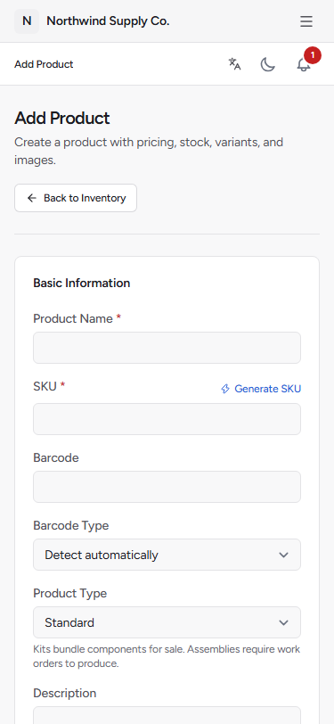 | 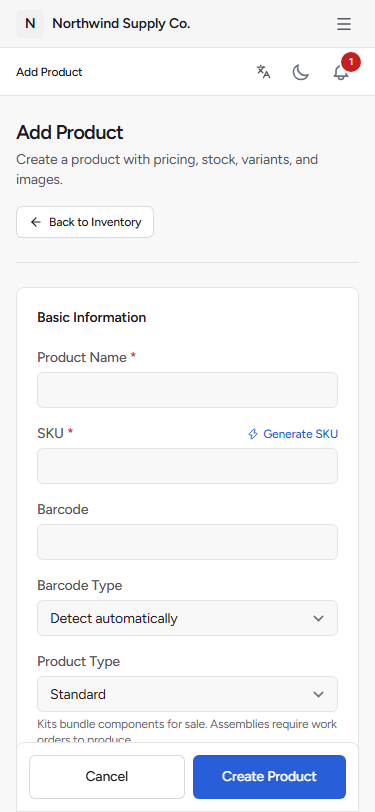 |
| Edit, phone | 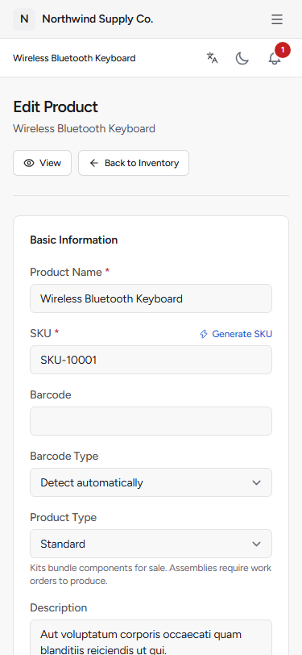 | 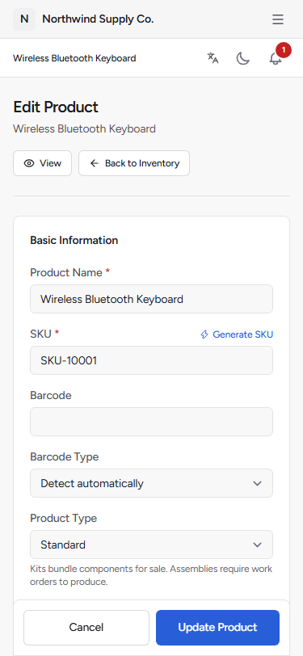 |
| Create, dark | 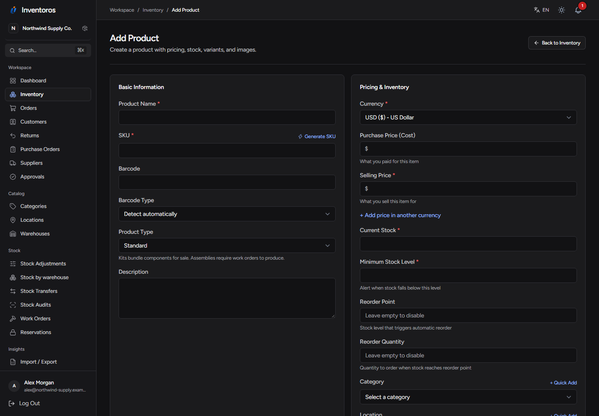 | 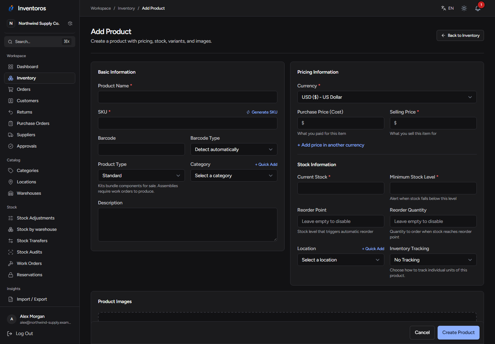 |
| Edit, dark | 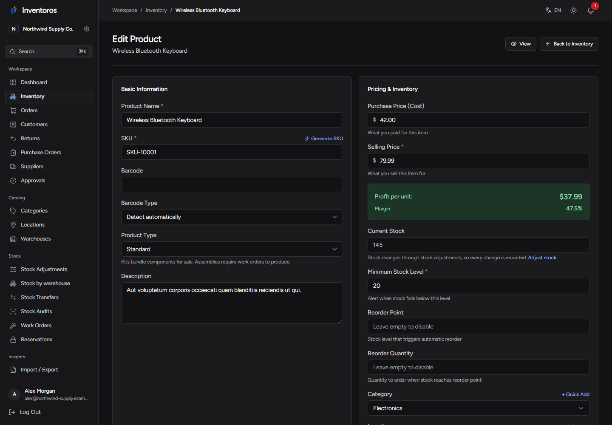 | 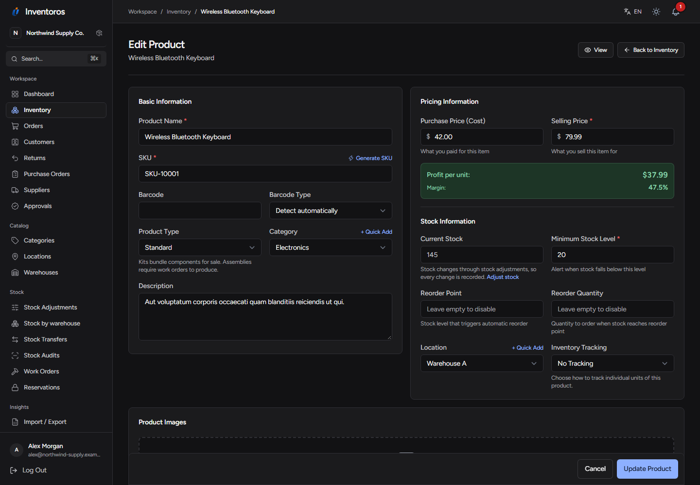 |

The measurement JSON beside each image set records document height, stock/submit positions, and page overflow.

## Verification

- Production build passes; no new dependencies.
- All 226 JavaScript tests pass.
- All 41 `ProductControllerTest` cases pass (165 assertions).
- Seven focused Chromium tests pass: action visibility while scrolling at 320, 375, 768, 1024, and 1440 px; native validation focus; create/update, pending submission, duplicate-SKU errors, read-only stock; and existing-image preservation.
- German and Arabic checked at 320 px, including RTL, translated action wrapping, 44 px minimum targets, and no page overflow. Axe reports no violations in the new action bar in either language. This is a scoped accessibility check, not a full application audit.
- Light, dark, and phone screenshots inspected. No custom animation added.

The UI Skills MCP catalog supplied [Baseline UI](https://www.ui-skills.com/skills/ibelick/baseline-ui/llms.txt) and [interface-polish guidance](https://www.ui-skills.com/skills/jakubkrehel/make-interfaces-feel-better/llms.txt). The existing design system remains the source for visual decisions.

## Reproduce

Use a disposable installation, seed the two screenshot seeders, build the target revision, and prepare a Playwright login for the demo user. Run `capture.mjs before` against main and `capture.mjs after` against this branch, using equivalent copies of the fixture database.

The capture script requires `CAPTURE_BASE_URL` and `PRODUCT_FORM_EDIT_PATH` (the fixture's edit URL), and accepts `CAPTURE_AUTH_STATE` (default `e2e/.auth/user.json`). It writes only the chosen local image/measurement directory.

The regression tests use the standard project setup:

```sh
npm run build
npm run test:js
php artisan test --filter=ProductControllerTest
npx playwright test e2e/tests/product-form-actions.spec.ts --project=setup --project=chromium
```
