# Record workspace design preview

This branch previews a quieter, denser Inventoros workspace for design review. It preserves the brand blue, existing navigation, permissions, actions and business logic.

## What changed

- Neutral light and dark surfaces, compact sidebar rows and clearer active navigation.
- Full-height record grids with subtle column separators, compact metadata, entity icons and localized totals.
- One divided dashboard metric strip, a compact replenishment review and flatter information panels.
- Grouped settings lists and a section navigation beside bounded account forms, with keyboard-accessible tabs.
- Shared primary and secondary actions use the same restrained surface treatment.

Tables retain their own scroll area, sticky headers, full-screen expansion, selection, filters and pagination. The legal footer stays below the pagination row.

## Before and after

These are actual browser captures from the released application and this branch using copies of the same disposable QA database. Desktop viewport: 1440 × 1000. Mobile viewport: 375 × 812. Browser scrollbars slightly reduce the captured dashboard image area; each before/after pair has matching image dimensions.

| View | Before | After |
| --- | --- | --- |
| Inventory | 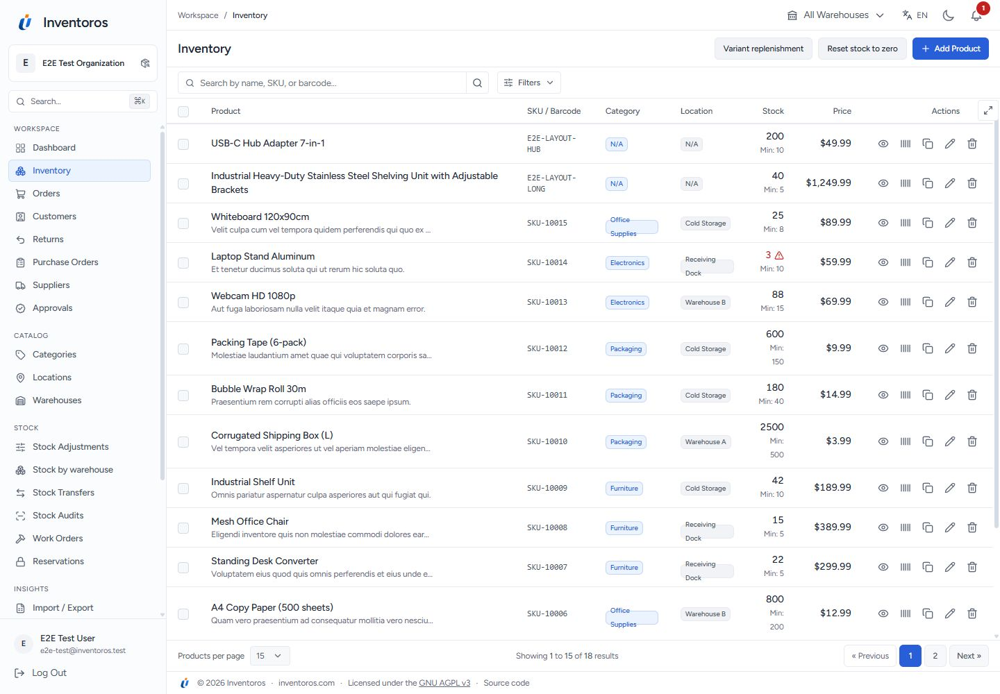 | 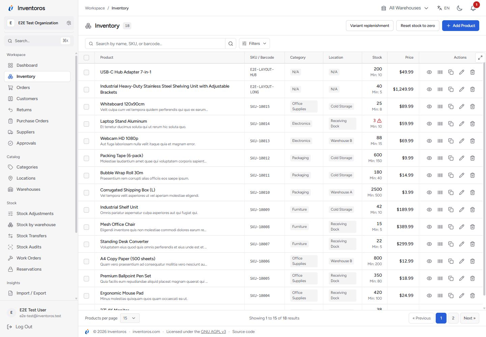 |
| Dashboard | 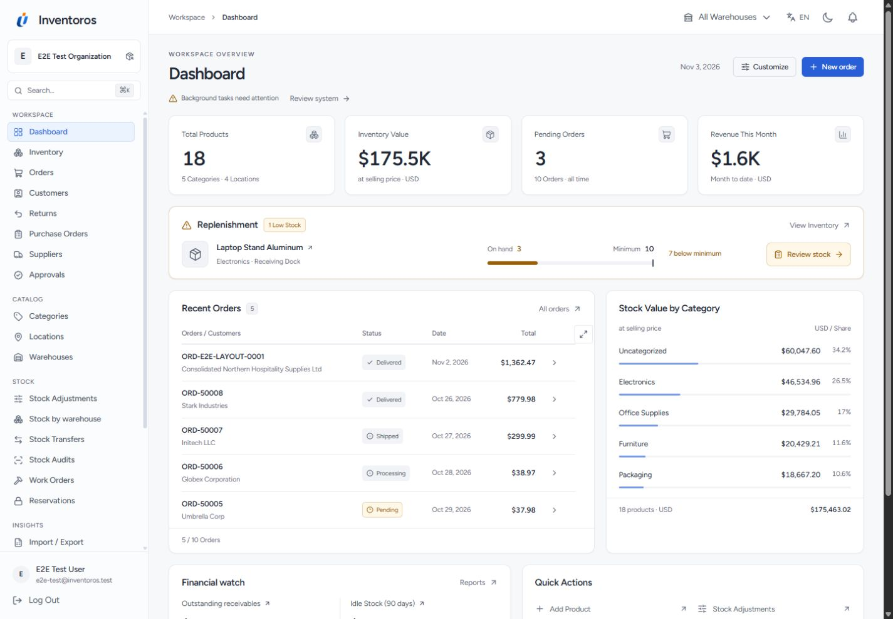 | 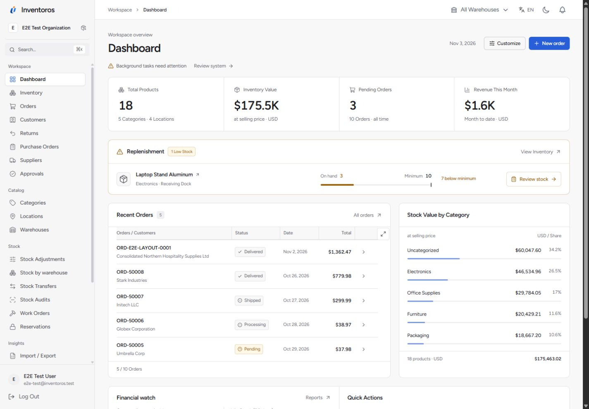 |
| Orders | 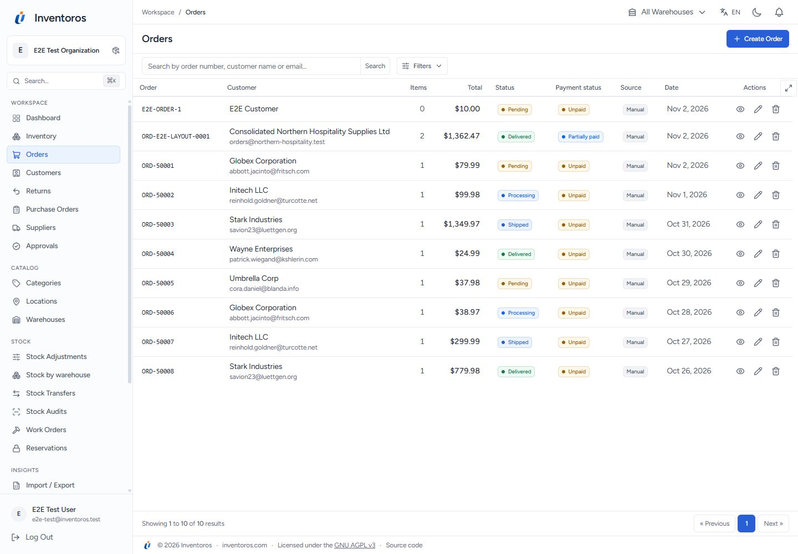 | 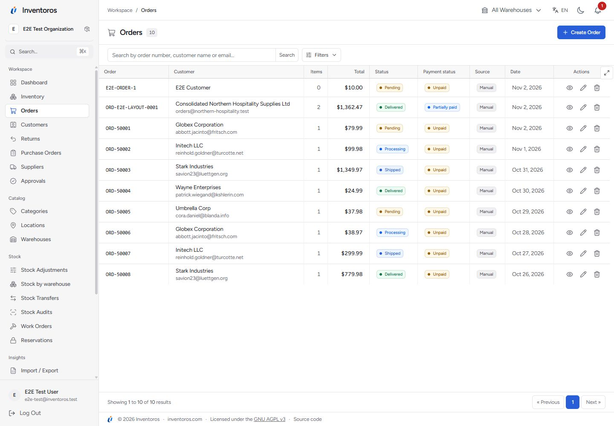 |
| Settings | 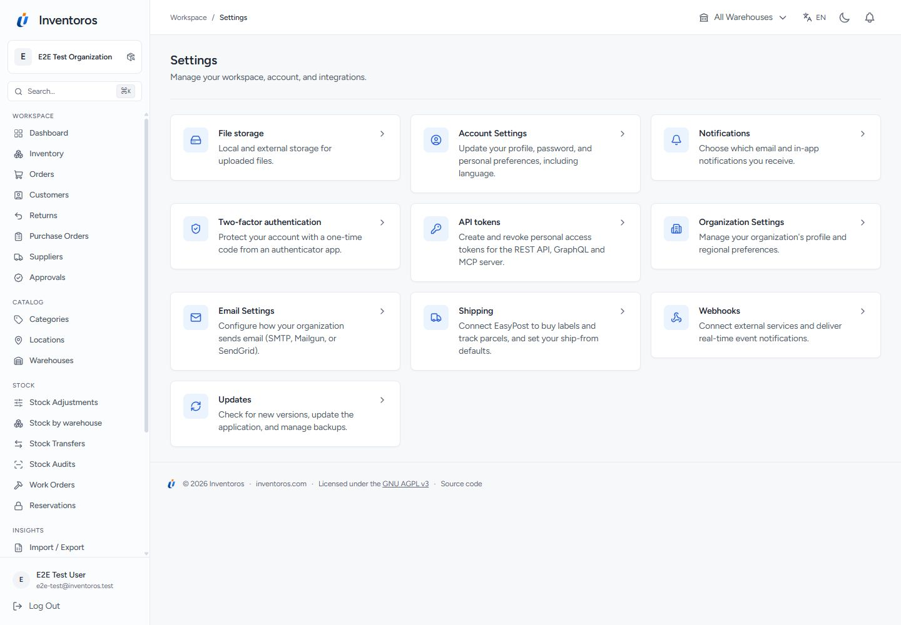 | 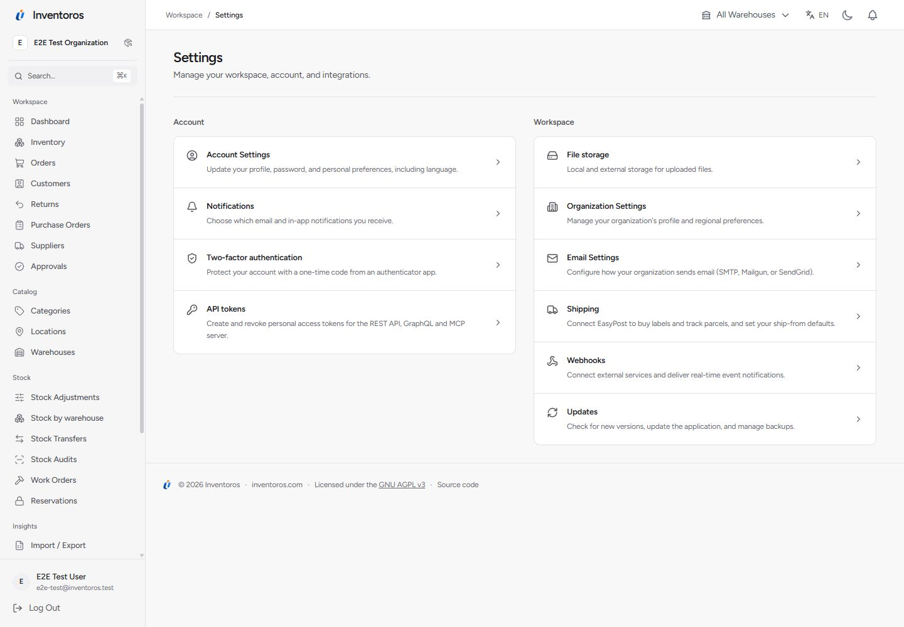 |
| Account | 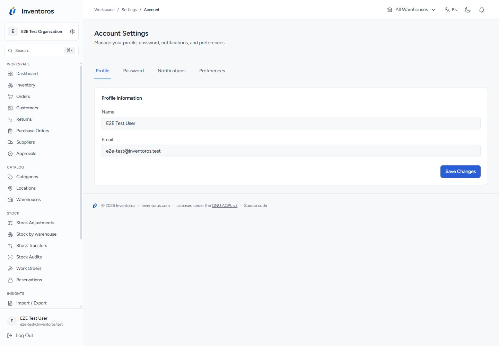 | 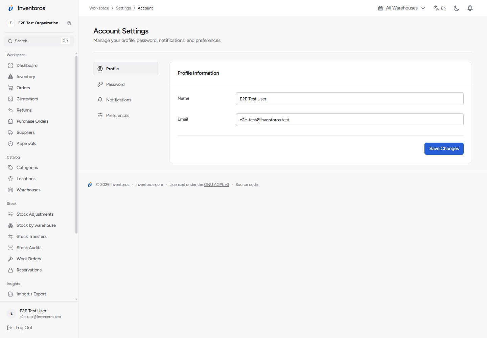 |
| Dark inventory | 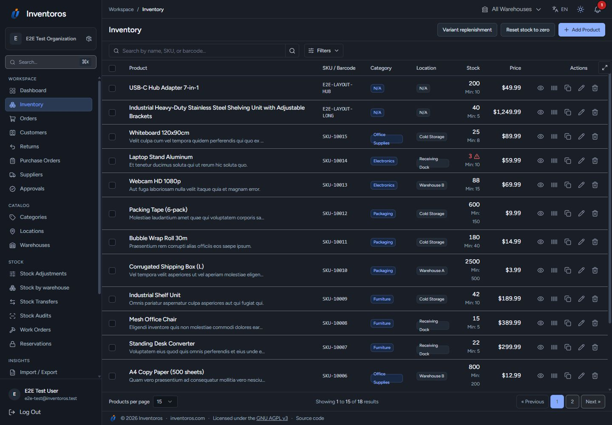 | 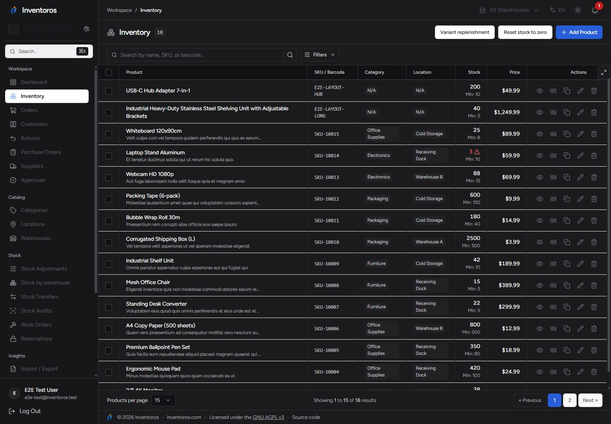 |
| Mobile inventory | 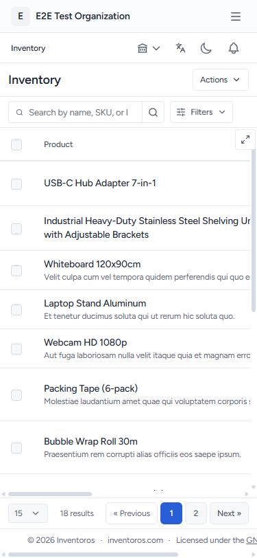 | 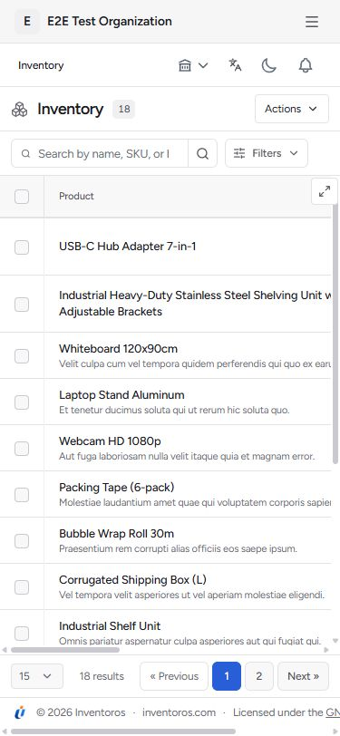 |
| Mobile dashboard | 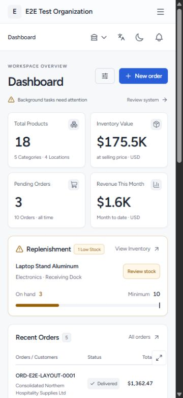 | 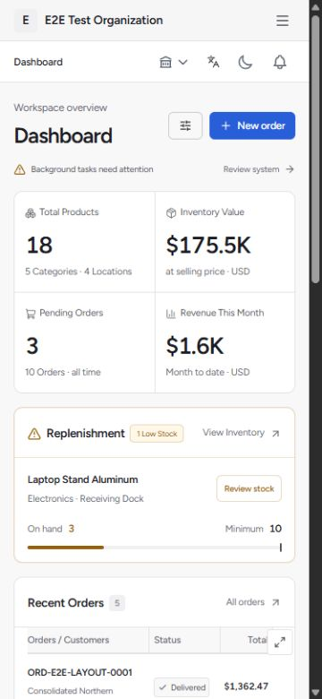 |
| Mobile account | 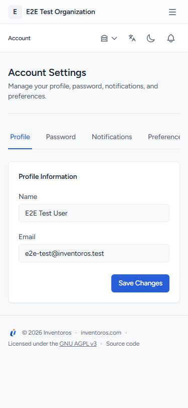 | 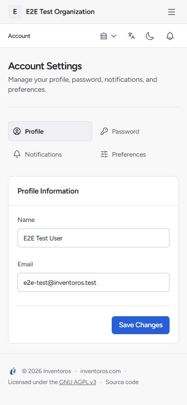 |

## Review focus

Compare the amount of visible record data, the hierarchy of actions, and the dashboard's scan order. Check whether the neutral active navigation and grouped settings improve everyday use. This is a reviewable implementation on a separate branch; the released application is unchanged.

## Verification

Verification results and browser evidence are recorded in the pull request. Regression coverage includes full table behavior, mobile headings, account tab navigation, themes and supported languages. No dependency or translation catalog changes are required.
